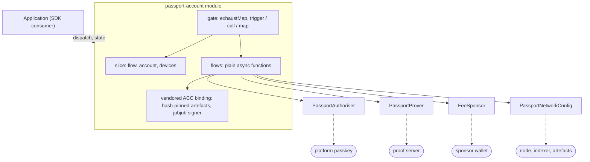
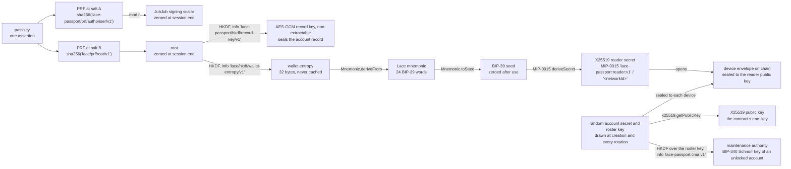
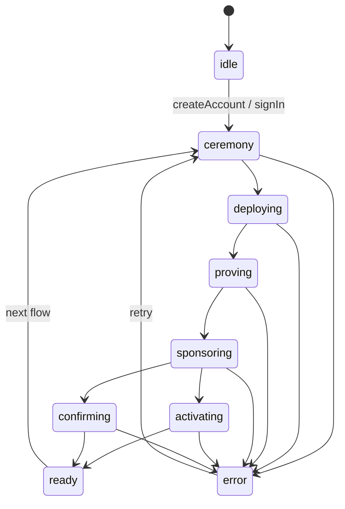
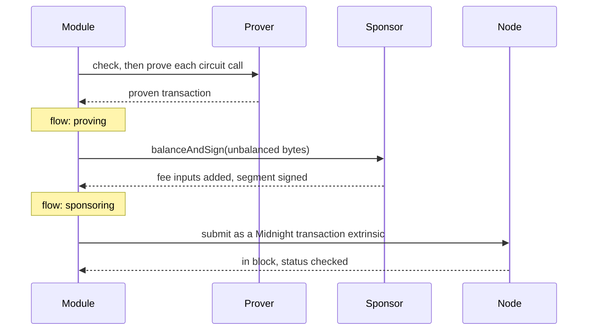
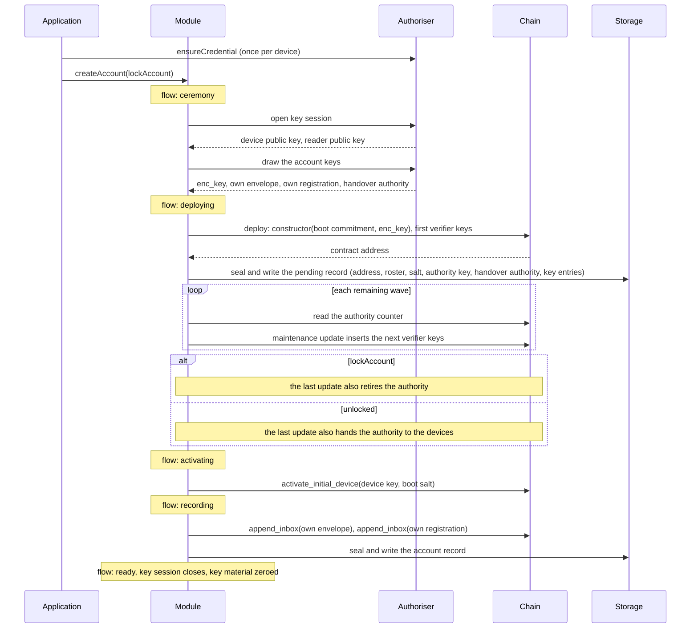
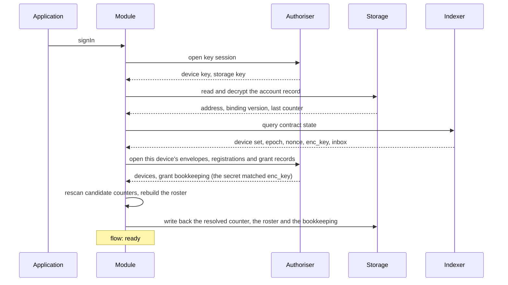
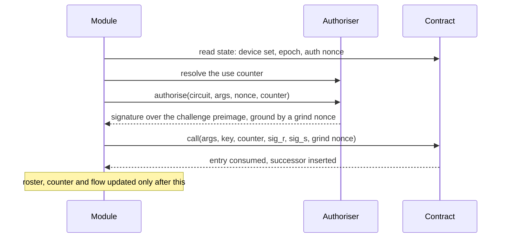

# @lace-module/passport-account

Passport smart accounts for Lace: an on-chain Midnight **Account Custody
Contract** (ACC) as the durable identity behind an account, standardised by
**MIP-0012** (contract custody of Midnight-native assets) and **MIP-0013**
(multi-key account authorisation). Device keys are held as revocable entries
on the contract rather than as the account's identity, so a device can be
enrolled or revoked without moving the account; the sole key source is a
platform passkey's WebAuthn **PRF** extension, which derives both the
device's signing scalar and the key that seals the persisted account record.
The account holds no funds of its own to pay fees: every transaction is
sponsored, so the user never needs Night or Dust to sign in, enrol a device,
or move assets.

Two properties follow from that shape and drive everything below. The user
holds no key material at rest, so there is no seed phrase and nothing to back
up. The user holds no tokens, so an account can be created and used with a
zero balance.

## Architecture

The module implements two contracts of the Lace module system:
`passport-store` (the `passport` slice and its side effects) and
`passport-dependency` (the platform capabilities the flows consume).
Four interfaces are supplied by the caller at construction, and everything
the module does against the network goes through one of them.



### Seams

The module is built around five small interfaces (`@lace-contract/passport`),
each swapped in by whatever the caller passes to
`createPassportAccountModule`:

| Interface               | First implementation (this package)                                                                                                                                                                                                                                             | Later replacement                                                                                                                                                |
| ----------------------- | ------------------------------------------------------------------------------------------------------------------------------------------------------------------------------------------------------------------------------------------------------------------------------- | ---------------------------------------------------------------------------------------------------------------------------------------------------------------- |
| `PassportAuthoriser`    | `createPasskeyAuthoriser` (WebAuthn PRF, production); `devJubjubAuthoriser` (in-memory key, internal to this package, used by its own tests only)                                                                                                                               | The P-256 arm the vendored contract already carries, which verifies passkey (ES256 WebAuthn) assertions natively; its keys are not installed (see "Constraints") |
| `PassportEncryptionKey` | `createPasskeyEncryptionKey` (this device's X25519 reader key, a MIP-0015 secret over the passkey-derived wallet seed, which opens the random account secret from this device's envelopes in the inbox, production); `devEncryptionKey` (in-memory seed, development and tests) | The wallet layer's own MIP-0015 connector once Passport accounts join a wallet                                                                                   |
| `FeeSponsor`            | `createDevSponsor` (funded localnet wallet pays every fee; local development only)                                                                                                                                                                                              | A hosted sponsor service, so no funded wallet is needed outside development                                                                                      |
| `PassportProver`        | `createHttpProver` (HTTP proof server, wire-compatible with midnight-js)                                                                                                                                                                                                        | Same interface; a managed proof-server endpoint in production                                                                                                    |
| `PassportNetworkConfig` | Plain network id plus indexer/node/artefact endpoints passed in by the caller                                                                                                                                                                                                   | Endpoint discovery/config owned by the consuming app                                                                                                             |

### Flows and the gate

Account creation, sign-in, device enrolment, device revocation, the three
grant operations (issue, revoke, revoke all), the shielded holdings read
and the operation install are each a plain async function under
`src/flows/`. Through
`FlowContext` a host supplies nothing but the five seams above, a
promise-based account-record seam, the relying party id a grant is bound
to, and an `onProgress` callback that a flow calls as it enters each stage
it reports; account creation, the grant flows and the operation install
report stages, sign-in, the device flows and the holdings read settle with
no intermediate stage.
Beyond that context, a flow drives the vendored binding and the network
clients itself. A flow never imports rxjs, redux, `@reduxjs/toolkit`,
redux-observable, `@lace-contract/module` or the store layer, so it is
platform neutral: it is what could move upstream unchanged if the flow
logic were ever needed outside this module.

The side effects that drive the slice run on observables, so they stay
marble-testable against a virtual scheduler. A flow's promise is turned into
an observable of its stages and its result exactly once, in the module's
`store/dependencies.ts`, and exposed to the side effects as `passportFlows`.
Nothing downstream of that wrapping ever touches a promise directly.

`passport-flows.ts` together with `flow-actions.ts` in
`src/store/side-effects/` turns each dispatched trigger into a flow start,
calls into `passportFlows`, and maps the resulting events onto slice actions.
The `exhaustMap` gate that makes every flow mutually exclusive and the
settled-flow guard that decides whether a device or grant call runs at all
also live there, because both are about coordinating dispatched actions
rather than any one flow's logic. The directory's other resident,
`restore-account.ts`, rehydrates the persisted record on startup and reads
the grant roster back from chain for it.

### State and stored data

The slice holds the account, the device roster, the grant roster, the
shielded holdings, the resolved use counter, the id of the last grant
issued, and one flow value with its error. A roster changes only after a
chain call is confirmed, and the holdings only once a walk has verified
them: `addDevice`, `removeDevice`, `issueGrant`, `revokeGrant`,
`revokeAllGrants`, `readShieldedHoldings` and `installOperations` are
trigger actions that clear the previous error and touch nothing else, so
a failed call never leaves state disagreeing with the contract.

| Location            | Contents                                                                                                                                                                                                                                 | Lifetime                   |
| ------------------- | ---------------------------------------------------------------------------------------------------------------------------------------------------------------------------------------------------------------------------------------- | -------------------------- |
| Contract (on chain) | Device entry set, device epoch, device count, auth nonce, encryption key, inbox of sealed coin descriptions and of the account keys and grant bookkeeping sealed to the devices, maintenance authority, grants map, grant generation     | Permanent                  |
| Slice (memory)      | `account`, `devices`, `grants`, `shieldedHoldings`, `lastIssuedGrantId`, `localUseCounter`, `flow`, `flowError`                                                                                                                          | Session                    |
| Account record      | `address`, `bindingVersion`, `localUseCounter`, sealed; plus the pending deployment until the account keys land, and the slot, scope salt, grantee key and origin of each grant this client issued                                       | Across sessions            |
| Device signing key  | JubJub scalar derived from the passkey                                                                                                                                                                                                   | One operation, then zeroed |
| Encryption key      | A random secret sealed in envelopes on chain to each device's reader key; the encryption key seam opens it for one call and hands back only public keys, ciphertexts and what the entries open to, so the secret never enters the module | One call                   |

The module never holds the encryption secret. The account secret is drawn
at random by the seam it consumes, `PassportEncryptionKey`, when the
account is created and at every rotation, and it reaches a device only
sealed in a device envelope, an inbox entry addressed to that device's
X25519 reader key, which the seam derives from the device's own key
source. Account creation draws it, deploys the contract with its public
key as `enc_key` and appends the creating device's envelope once the
device is active; sign-in and the holdings read hand the seam the
envelopes addressed to this device, newest first, with the inbox entries
to open, and the seam opens the secret whose public key is the ledger's
`enc_key` and answers with what the entries hold; a rotation asks it for
a fresh secret sealed to every enrolled device and for the live holdings
re-encrypted towards it. The secret stays wherever the key source lives:
the seam opens it for the one call and zeroes it before returning. The
holdings the walk verifies are kept in the slice as plain records and
never persisted.

The account record is sealed with AES-GCM under a key derived in the same
ceremony as the signing key. The stored value is `{ v: 1, iv, ciphertext }`
with a fresh 12-byte IV per write, so nothing about the account is readable at
rest, and a record that fails to decrypt is reported as corrupt rather than
treated as absent. While a creation is unfinished the record also carries
the deployment in progress, including the deploy-time maintenance
authority key that signs the remaining waves, the last of which replaces
it; it is the one secret the record ever holds, and the write that
completes the record drops it (see "Deployment waves"). In memory it is a
ledger signing key, a kind tag and the secret as a hex string, which the
in-memory private state provider also keeps while the flow runs; a string
cannot be zeroed, so those copies survive until collection. The
envelope then also carries `pending: true` beside the ciphertext: one
plaintext bit, not a secret, that tells an unfinished creation from a
completed account without opening the record, so creating an account over
a completed record is refused before any ceremony. Once a grant is issued
the record also keeps, per grant, the slot its id was derived under and
the scope salt its commitments hide under, with the grantee key, its
scheme and the origin, because the contract stores neither: the slot is
what lists the grant with its position and the salt is what opens the
grant for its grantee. They stay inside the ciphertext; nothing about a
grant is marked on the envelope. The same bookkeeping also lives on chain,
in grant records only this device opens on that account, so a lost record
costs nothing a sign-in cannot rebuild; the roster of devices the account
keys are sealed to is never kept in the record, a rotation reads it from
the chain each time.

### Key material

One passkey assertion yields everything the module needs. The PRF extension is
evaluated at two salts in the same ceremony, each the SHA-256 of a fixed
label, so the two outputs are domain separated and neither can be derived from
the other. The first output is the device secret and reduces to the JubJub
signing scalar. The second is the root, and it never leaves
`@lace-lib/passkey`, which owns the ceremony. The record key that seals the
account record is an HKDF-SHA256 derivation from the root under a fixed info
label, cached for the life of the key source. The passkey library derives
wallet entropy, Lace mnemonic, and BIP-39 seed internally. None of that wallet
material is cached or passed to the Passport adapter. `PasskeySessionKeySource.deriveSecret`
reuses the active key session and returns only the requested domain-scoped
secret. Wrappers and custom sources implement `deriveSecret` to work with
`createPasskeyEncryptionKey`, which asks for this device's reader secret,
uses it inside the one seam call, zeroes it and maps library errors to
Passport errors. The internal BIP-39 seed is what
[MIP-0015](https://github.com/midnightntwrk/midnight-improvement-proposals/blob/main/mips/mip-0015-wallet-derived-deterministic-secrets.md)
(status Proposed, pinned to its revision of 2026-08-18) calls its seed:
the key source walks it to the device's reader secret (domain
`lace-passport:reader:v1`, context `<networkId>`), an X25519 secret whose
public key the account's envelopes to this device are sealed to, distinct
per network so no observer links a passkey's envelopes across networks.

The account secret is not derived from anything. It is random, drawn when
the account is created and again at every rotation, and the chain is where
it lives: each enrolled device holds one envelope per secret it was handed,
the secret and the roster key sealed to its reader key, and finds its
envelopes by their recipient tag, which only someone holding its reader
public key can recompute. The tag covers the whole envelope, so an entry
that copies a genuine envelope's tag over any other bytes is not taken
for one, and forging a new envelope to a device takes its reader key;
anyone can still replay a genuine envelope verbatim, which costs the
device time and nothing else. A device trusts an opened secret only once
its public key is the ledger's `enc_key`, since anyone who knows a
reader key may append an envelope to it. Envelopes are never removed, the inbox being append only, so a
device keeps opening the secrets it was handed. A walk tries every
envelope of the device until it finds the oldest that delivers the
secret deriving `enc_key`, so envelopes anyone appends to a reader key
cannot hide the live one, only cost the device time, and keeps at most
16 earlier secrets beside it (`MAX_KEYRING_SECRETS`), which only find
coins an interrupted rotation or a racing sender left under an earlier
key. Roster keys are never dropped: a maintenance update is signed with
the roster key, among every one the envelopes deliver, that derives the
authority on chain. Over the hosted signer, a device with more envelopes than one
request carries pages them to the signer, oldest page first, and sends
the envelopes from the live one on; a maintenance update instead sends
the live envelope beside each run of older envelopes in turn, until one
holds the roster key the authority on chain derives from. An
inbox that holds no envelope of this device opening `enc_key`, as for a
device never handed the keys or removed since, fails with
`EncryptionKeyMismatchError` rather than reading the inbox as empty. The
roster of enrolled devices lives on chain too, as device registrations:
each device's reader key and compressed device key sealed under the
roster key, a random key every device receives in its envelope and a
grant never does, drawn afresh at creation, whenever a device is removed
and at an enrolment while a read grant is live. On an unlocked account
the roster key also derives the contract's maintenance authority (see
"Maintenance authority"). The generic key source exposes no
root, entropy, or session mnemonic accessor. Cardano wallet callers use `withPasskeyMnemonic`
to consume words inside a callback. Each call makes a fresh assertion, even
while a Passport session is open.

Every step is one way: a leaked reader secret reveals neither the seed nor
the root nor any sibling secret, and none of these derivations ever takes a
device key as an input. A lost passkey loses only that device's copy of
the account secret, its reader key: any other enrolled device still opens
its own envelopes, so the shielded holdings survive the loss of the device
that created the account. The account secret is also the only way to read
the inbox: each coin entry is sealed under a key agreed between a sender's
ephemeral X25519 key and `enc_key`, so the chain, the indexer and every
other observer see only ciphertext, and a holdings read opens the secret
inside the key session, opens the entries and zeroes it before the walk
goes on. A read grant shares that secret with a grantee: the encryption
key seam seals the secret the key was just rotated to towards the
grantee's X25519 read key, as the GrantViewSeal container the scoped
grants standard defines, and the seal is what the agent policy carries;
the secret itself still never leaves the seam, and the seal opens only for
that read key, under that grant and for that account. The
passkey itself never leaves the platform authenticator; only PRF outputs
cross that boundary, and only named derivations cross the library's.

Who can observe each of these secrets, what an attacker holding one can do,
and the risks the design leaves open are set out in the
[Phase A key material threat model](../../../docs/security/passport-phase-a-key-material.md);
changes to this section and to that document belong in the same pull request.



The table indexes into that tree: what each secret comes from, how long it
lives and what clears it, and what disclosing or losing it costs. Every
derived entry is regenerable from the credential; the account secret and
the roster key are random, and they are regenerable from any enrolled
device's envelope, since every device holds its own copy on chain, and so
is the maintenance authority the roster key derives.

| Secret                        | Derived from                                                                                                                                                                           | Lifetime                                                                                                                                                                                                                                                                                                                                                                                                                            | If disclosed                                                                                                                                                                                                                                                                                                                                            | If lost                                                                                                                                                             |
| ----------------------------- | -------------------------------------------------------------------------------------------------------------------------------------------------------------------------------------- | ----------------------------------------------------------------------------------------------------------------------------------------------------------------------------------------------------------------------------------------------------------------------------------------------------------------------------------------------------------------------------------------------------------------------------------- | ------------------------------------------------------------------------------------------------------------------------------------------------------------------------------------------------------------------------------------------------------------------------------------------------------------------------------------------------------- | ------------------------------------------------------------------------------------------------------------------------------------------------------------------- |
| Device scalar                 | PRF output at salt A, reduced mod the JubJub group order                                                                                                                               | The per-call copy is zeroed after the call (`ceremony/passkey.ts`); the session's PRF output is zeroed when the session closes (`@lace-lib/passkey`'s `key-source.ts`)                                                                                                                                                                                                                                                              | Spend authority on the account: the holder can forge every gated-call authorisation                                                                                                                                                                                                                                                                     | Regenerable from the credential; nothing else is affected                                                                                                           |
| Root                          | PRF output at salt B                                                                                                                                                                   | The open key session, or one ceremony outside it; zeroed when the last session holder settles, and never returned by any accessor                                                                                                                                                                                                                                                                                                   | Everything derived below it (record key, wallet entropy, seed, reader secret), so it is the single point worth protecting, as serious as the device scalar's exposure though it grants no device authority on its own; through the reader secret it reaches the roster key, and with it full custody of an unlocked account                             | Regenerable from the credential                                                                                                                                     |
| Record key                    | HKDF-SHA256(root, info `lace-passport/hkdf/record-key/v1`), a non-extractable AES-GCM key                                                                                              | Cached in the key source for as long as that instance lives, since it carries no signing authority                                                                                                                                                                                                                                                                                                                                  | Read access to the local account record: the address, binding version and use counter, and, until the creation completes, the pending deployment with the contract's maintenance authority key, which is full custody of that contract                                                                                                                  | Regenerable from the credential; the sealed record simply fails to open until then                                                                                  |
| Wallet entropy                | HKDF-SHA256(root, info `lace/hkdf/wallet-entropy/v1`)                                                                                                                                  | Exists only inside the key source for one Passport derivation or wallet callback; never cached                                                                                                                                                                                                                                                                                                                                      | The Lace mnemonic and everything derived from it: every chain wallet and the reader secret, and through it every account secret and roster key this device was handed                                                                                                                                                                                   | Regenerable from the credential                                                                                                                                     |
| Seed                          | `Mnemonic.toSeed(Mnemonic.deriveFrom(entropy))`                                                                                                                                        | One `deriveSecret` call; zeroed before the call returns                                                                                                                                                                                                                                                                                                                                                                             | The same as wallet entropy, since a conforming wallet built from the same words derives the same seed                                                                                                                                                                                                                                                   | Regenerable from the credential                                                                                                                                     |
| Reader secret                 | `deriveSymmetricSecret(seed, { domain: 'lace-passport:reader:v1', context: '<networkId>' })`, one per network                                                                          | One call of the encryption key seam: derived, used to open this device's envelopes and grant records or to seal its grant records, and zeroed before the call returns, inside the key session when one is open                                                                                                                                                                                                                      | Every account secret and roster key this device was handed, and its grant bookkeeping; never device authority, but full custody of an unlocked account whose live roster key is among them, through its maintenance authority                                                                                                                           | Regenerable from the credential; nothing is stranded                                                                                                                |
| Account secret and roster key | Random, drawn by `createKeys` at creation and at every rotation; the roster key drawn afresh only at creation, when a device is removed and at an enrolment while a read grant is live | Lives sealed on chain, one device envelope per enrolled device and secret; opened from this device's envelopes for one seam call, used to open or re-encrypt inbox entries, seal the next secret, or seal a grantee's view, and zeroed before the call returns; the module receives only public keys, ciphertexts, opened coin descriptions and bookkeeping, or the seal                                                            | The account secret: read access to the contract's inbox, so shielded holdings become visible, but never spend authority, matching the custody standard's own leak model; a read grant shares exactly the account secret, sealed, until the next rotation, never the roster key. The roster key: on an unlocked account, the maintenance authority below | A device that loses its passkey loses only its copy; any other enrolled device opens its own envelope, and a rotation hands a new secret to the devices that remain |
| Maintenance authority         | HKDF-SHA256(roster key, empty salt, info `lace-passport:cma:v1`), a BIP-340 Schnorr key, on an unlocked account only                                                                   | Derived inside one encryption key seam call, to answer its verifying key or sign one maintenance update the seam built itself, and its 32-byte HKDF output zeroed before the call returns; the ledger signing key built from it holds the same secret as a hex string and in wasm memory, which the ledger API cannot zero, so both survive until collection; on chain only as the verifying key, which a fresh roster key replaces | Full custody: a maintenance update can replace any verifier key and the authority itself. Lace signs only pinned installs of the deployed roster and the move to a fresh roster key, but a holder of the roster key can sign anything outside Lace                                                                                                      | Regenerable from any device handed the account keys; with every such device lost, nothing more can be installed                                                     |

A flow calls the authoriser several times: for the public key, for entry
commitments, and for the call signature. Each call on its own would mean one
user prompt, so the authoriser offers a key session: the ceremony runs once at
the open and every nested call reuses the derived key. The session counts the
flows holding it and closes on the last one out, because a flow that joined an
open session would otherwise lose its key mid-operation if the opener settled
first. This is the only caching of signing material.

When the key lives with the Lace signer page, the session is the one a
`flow-open` holds there (`remote/signer-handlers.ts`), and the approval it
cost covers one flow only. The signer serves that session to the requests
the approved flow makes and nothing else: create-account resolves the
device and reader keys, draws the account keys, derives commitments,
appends its own envelope and registration and writes the record; sign-in
resolves the same keys, reads the record and opens its keys and
bookkeeping from the inbox; a device flow derives commitments, authorises
its own circuit (`add_device_with_jubjub` or `remove_device_with_jubjub`)
for the one commitment and account its descriptor named, and reads and
writes the record, so the grant bookkeeping it carries survives the write;
an enrolment whose descriptor names the joining device's reader and device
keys also seals the account keys to that reader alone and appends them; a
removal always rotates the account keys; a grant flow does the same with
its own circuit (`issue_grant_with_jubjub`, `revoke_grant_with_jubjub` or
`revoke_all_grants_with_jubjub`), an issue also sealing the grant's
bookkeeping exactly as its descriptor names it; a holdings flow asks for
the reader key and sends the inbox entries to open with this device's
envelopes, and the signer answers with the coin descriptions, never the
secret. A grant flow that shares or withdraws the viewing secret, an issue
whose scope reads or a revocation whose descriptor says it rotates, and a
removal, also get the rotation they run ahead of their call: the inbox
opened with the live keyring, the fresh account keys sealed to this device
and the registered devices the descriptor lists, the re-encryption
towards them and the
`rotate_enc_key_with_jubjub` and `append_inbox_with_jubjub` circuits; a
grant session that does not read cannot rotate the key. The account secret
is never derived, so no rotation can lead back to an earlier one: the
rotate call must carry a key this session drew, each append an entry this
session sealed (or, when a creation resumes, a key entry the pending
deployment the signer stores recorded), and the fresh secret is sealed to
this device, whose device key the request must name, and to readers the
live roster key registers whose device key derives, at the epoch and
counter the request names, a distinct one of the device entries the
descriptor lists; consent shows how many devices keep the viewing key and
each entry in short form, and a removal's list leaves its target out.
The signer refuses to sign a removal unless the session rotated with a
fresh roster key first, refuses a keyring of another account, and keeps
the `enc_key` values its sessions rotated away from per account and
network and refuses a keyring naming one. A removal, and an enrolment
that rotates, also sign through `sign-maintenance-update` the move of an
unlocked account's maintenance authority, only as a replace over the
keyring of the key the session rotated to and only towards the authority
the roster key that session drew derives, and ask beforehand through
`holds-maintenance-authority` whether this device's keyring derives the
authority on chain, which answers a boolean and signs nothing; an install session resolves
the reader key and the live envelope and signs only the verifier key
inserts of the operations its descriptor names, calling no circuit. An
`open-inbox` answers a
holdings read with coins alone, a sign-in with only the grant records of
grants issued under the asking origin, and a rotating flow with coins and
registered devices. The secret leaves such a session only sealed, through
`seal-view`, and only for the key the session rotated the account to and
towards a read key the user approved: the descriptor's for the grant an
issue issues, and for any other live read grant, which an issue, a
revocation and a removal all re-seal, one an earlier issue was approved
for on the same signer, which keeps its own record of approved read keys
per account and network, forgets a grant's key once its revocation is
signed and every key of an account on a revoke-all, and never seals to the
revoked grant. Each descriptor carries exactly what its flow binds and
nothing else: a device flow its commitment (lowercased on both ends, so a
dApp may accept it in either case) and account, for an enrolment that
hands over the keys the joining device's reader and device keys, which
the signer holds to the enrolled entry at use counter 0, and for a
removal the device entries that keep reading, a revoke-grant flow its
grant id and, when the revocation rotates, a read flag with the account
whose key it rotates and the device entries, a revoke-all flow those
alone and a holdings flow nothing, and an issue-grant flow the account,
the grant id, the scope the user is asked to grant, the read key of a
read grant inside it, the slot, the scope salt, the scope digest and, for
a read grant, the device entries, and an install-operations flow the
account and the operations it installs, each of the deployed roster and
none twice.
The authorisation is then held to the descriptor: a device or revoke-grant
authorisation's single argument must be the bytes of that commitment or
grant id, a revoke-all authorisation must carry none, and an issue-grant
authorisation must name the descriptor's account and read back, through
the same parser the authoriser derives its challenge from, to the
descriptor's grant id and scope digest, so an approval to enrol or revoke
one device, or to issue or revoke one grant, cannot sign for another or
over another scope. A request outside the flow's list, an authorisation
for another circuit, or one for another argument, is refused with
`flow-scope` before the key source is touched. An inbox request carries at
most 4,096 entries and 4,096 envelopes; a device with more envelopes has
them paged through `find-live-envelope`, which answers only where in the
page the live one sits. The session also expires five
minutes after it opened, long enough for a localnet deploy with proving
but bounded so a forgotten window does not hold key material: the signer
releases it as a `flow-close` would, the key source zeroes its outputs,
and the flow's later requests are refused with `session-expired`.

An issue-grant descriptor is verified before the ceremony, so a dApp
cannot show one scope and have another signed, and cannot bind a grant to
a site it does not control. The signer re-derives the scope digest from
the carried scope and salt with the contract's own pure circuit, and the
grant id from the carried account, the grantee key and the slot and from
the origin it observed on the message channel: the client id that enters
the origin hash is the hostname of the dApp origin the browser attested
when the channel was handed over, which is the relying party id the module
defaults to on that origin, and never a value the dApp claims. A digest or
id that differs from what the dApp sent is refused with
`grant-binding-mismatch`; a descriptor missing a field, carrying one its
kind does not bind, or naming a rolling window, with `malformed-payload`;
and a scope the contract would not issue, a shielded operation without
read or a read grant without a canonical read key among them, with
`grant-scope-invalid`, the same refusal the local flow gives. The digest
covers the hash of the read key, so the key the user sees is the key the
secret is sealed to. All
three cost no ceremony. The scope digest the dApp sends is the one its own
flow derived when it prepared the call, so the dApp-side seams of the
protocol never evaluate the contract module; the signer shows and signs
the one it re-derived, which the check has made the same. A dApp whose
relying party id is not its hostname cannot issue grants through the
signer, since its grant ids re-derive to another origin hash.

| Flow                                      | Ceremonies                               |
| ----------------------------------------- | ---------------------------------------- |
| Create account, first account on a device | 2 (one creates the passkey, one uses it) |
| Create account, passkey already enrolled  | 1                                        |
| Sign in                                   | 1                                        |
| Add device, remove device                 | 1 each                                   |
| Issue grant, revoke grant, revoke all     | 1 each                                   |
| Read shielded holdings                    | 1, or none over an empty inbox           |
| Install operations                        | 1                                        |

Passkey creation returns no PRF output, so the first account on a device
cannot be reduced below two. Over the signer, an issue-grant session is
opened only once the descriptor's grant id and scope digest re-derive on
the signer; the key session, and with it the ceremony, comes after that
check.

### One gate over all flows

Account creation, sign-in, device enrolment, device revocation, the grant
operations, the holdings read and the operation install run through a
single `exhaustMap` rather than one each. They are mutually exclusive:
every chain call among them
resolves the same device's use counter and writes the same account record,
so two in flight can authorise against the same counter and auth nonce,
leaving one transaction to consume the entry and the other to fail with
the local roster disagreeing with chain; the holdings read spends no entry
but opens the same key session and reports through the same flow state.
A dispatch that arrives while another flow is running is dropped, the same
silence `exhaustMap` already gives a repeated dispatch of one action.

The gate cannot be built on the flow value. State reaches a side effect before
the action does, and a running flow is still subscribed while its own terminal
`setFlow('ready')` is being delivered, so a guard reading the flow back cannot
tell a request the gate will accept from one it will drop. Exclusion is
therefore structural.

Because only the gate knows which requests it accepted, it also owns the entry
into `ceremony`. The trigger actions are pure: they carry the request and
change nothing. A dropped request leaves the running flow's state untouched,
and an accepted one enters `ceremony` synchronously, within the same dispatch
cycle as the trigger.

### Flow states

One value reports progress for every flow. Each path settles: a success ends
at `ready` and clears the previous error, a failure ends at `error` carrying a
typed code. A device call may start from `error`, so a retry does not need a
fresh sign-in ceremony, which is why a device success has to move the flow
back rather than leave it where it was.



`proving` and `sponsoring` are reported from inside the transaction pipeline,
so they recur for each transaction a flow submits; a grant call reports them
for its one transaction, from `ceremony` straight to `proving`, and then
`confirming` while it waits for the indexer to reflect the accepted call,
which can lag the block the call landed in by several seconds. A grant
call that rotates the encryption key, and a device removal, report
`rotating` before the appends that deliver the new keys and the rotation's
own transaction, and `reencrypting` before the appends that re-encrypt the
holdings, one transaction each, and only then their own transaction and
`confirming`. `recording` precedes the appends that deliver the account
keys to a new device, or a grant's bookkeeping and seals, to the inbox. A grant call
whose roster never reflects it settles on `error` with
`grant-roster-unsettled`; its record already holds the call's bookkeeping, so
the next sign-in reads the roster back once the indexer catches up.

Every accepted trigger enters `ceremony`, device and grant calls and the
holdings read included, because the gate enters it before the flow's own
guards run. A call the
gate accepts but the settled-flow guard refuses to call, because no account
is in state or the current flow has not settled, therefore passes through
`ceremony` before settling on `error` with `no-account`; it opens no key
session and touches no chain state on the way.

| Condition                                                        | Reported as                      |
| ---------------------------------------------------------------- | -------------------------------- |
| User dismissed the passkey prompt                                | `ceremony-cancelled`             |
| Authenticator has no PRF support                                 | `prf-unsupported`                |
| Downloaded artefact does not match its pin                       | `artefact-integrity`             |
| Sponsor could not cover the fee within its budget                | `sponsor-exhausted`              |
| Create dispatched while a record already exists                  | `account-exists`                 |
| No account record stored on this device                          | `account-not-found`              |
| No live contract at the stored address                           | `account-contract-missing`       |
| No envelope of this device opens the contract's `enc_key`        | `encryption-key-mismatch`        |
| Joining device keys do not match the enrolled entry              | `device-reader-invalid`          |
| Registrations landed during a rotation                           | `device-roster-invalid`          |
| Sealed record found but the authoriser has no storage key        | `record-unreadable`              |
| Authority retired before every verifier key wave landed          | `authority-retired`              |
| Locked creation resumed over an activated, unretired authority   | `authority-not-retired`          |
| Creation resumed under another lock choice than it started with  | `creation-lock-mismatch`         |
| Creation resumed under other verifier key pins than recorded     | `creation-artefact-mismatch`     |
| Sign-in found a record whose creation is unfinished on chain     | `account-creation-pending`       |
| Stored record will not decrypt                                   | `record-corrupted`               |
| Contract rejected the caller (signature or device key)           | `not-authorised`                 |
| No device entry within the probed counter windows                | `device-entry-not-found`         |
| Removal target entry no longer in the on-chain set               | `removal-target-not-found`       |
| Removal would leave no device, or removes the caller             | `last-device`                    |
| Device, grant or holdings flow attempted without a ready account | `no-account`                     |
| Grant scope breaks a rule, or asks what the contract refuses     | `grant-scope-invalid`            |
| Sixteen grants already active                                    | `grant-limit-reached`            |
| Grant named for revocation is not on the ledger                  | `grant-not-found`                |
| Grant named for revocation is already revoked                    | `grant-revoked`                  |
| Contract refused an issue over an active grant id                | `grant-issue-rejected`           |
| Issue dispatched by a host with no relying party id              | `grant-origin-missing`           |
| Indexer never reflected the accepted grant call                  | `grant-roster-unsettled`         |
| No roster key of this device derives the authority on chain      | `maintenance-authority-mismatch` |
| Maintenance update asks for a change the key does not sign       | `maintenance-update-refused`     |
| Install names an operation outside the roster, or none           | `operation-not-installable`      |

## Flows

### Transaction pipeline

Every chain write follows the same three steps. The module never holds funds,
so proving and payment are separate concerns joined here. A submission whose
finalized status reports failure rejects, so no local state advances for a
call the contract did not accept, and a rejection caused by a stale dust view
is retried while any other rejection fails the flow.



### Account creation

The contract cannot know its own address while its constructor runs, so
creation ends with a permissionless call that presents the device key and
the boot salt the constructor committed to, installing the first device
entry. Before that call the contract's verifier keys are installed in
waves (see below): the deploy carries the first batch, and each later wave
is one maintenance update signed by the authority the deploy minted. The
last wave also replaces that authority: it retires it when the account is
locked, and otherwise hands it to the account's devices, as the key the
roster key derives. The
account keys are drawn before the deploy: a random secret, whose public
key the constructor stores as `enc_key`, and a random roster key, sealed
to this device's reader key in its envelope, with this device's
registration under the roster key. Both entries are recorded with the
pending deployment and appended to the inbox once the device is active,
so the account keys are on chain before the creation completes.

The deploy and each wave expire a minute after they are built, which is
before the sponsor balances them. A sponsor can need setup first, such as
the development sponsor's first wallet sync, so the flow awaits the
sponsor's optional `ready` before building each of them, and that setup
never counts against the expiry.



Each chain step is the pipeline above, so the proving and sponsoring stages
repeat per transaction.

#### Deployed circuits

The compiled contract carries three authorisation arms (jubjub, k256 and
P-256), scoped grants and recovery. This module installs nineteen
operations: the two permissionless deposits, the eight jubjub device
circuits, the six jubjub grant circuits (issuing a grant, revoking one,
revoking all, and the three withdrawals a jubjub grantee may run under a
grant) and the three k256 grant withdrawals a secp256k1 ECDSA grantee runs
instead. The device arm is jubjub only: no k256 or P-256 device, activation
or grant lifecycle keys are installed, so on an account created here only
jubjub devices can ever authorise, while a grant they issue may name a
jubjub or a secp256k1 ECDSA grantee. Every verifier key is downloaded from
the artefact bundle and checked against the sha256 pin the vendored
contract carries for it before it is placed on chain; a key whose digest or
header disagrees fails before any transaction is built.

#### Deployment waves

The nineteen verifier keys exceed what one transaction may carry: the node
refuses a transaction carrying more than about 15,000 verifier bytes for
exhausting the block limits. The deployment is therefore planned as waves
under a 15,000 byte budget, packed greedily in roster order from the
sizes of the keys as downloaded: the deploy carries the longest prefix of
the roster that fits, activation included, and each later wave the next
batch. The plan follows the real keys, so a change in the roster or in a
key's size re-plans itself.

Each wave after the deploy is one contract maintenance update that inserts
its batch of verifier keys, signed by the maintenance authority key the
deploy minted. The update must name the authority counter the chain
expects, and every applied update advances it, so the counter is read
from chain before each update and the next one waits until the chain
shows the previous one applied; the first update likewise waits until
the indexer serves the contract the deploy created. The last update also
replaces the deploy-time authority, so neither choice costs a
transaction of its own: a locked account gets an unsatisfiable one, which
no later update can undo, and an unlocked one the authority its roster
key derives, alone at threshold 1, which `createKeys` answered with the
account keys. The deploy-time key cannot hand over sooner, since the
creating device's envelope reaches the chain only after activation and
until then no keyring opens the roster key.

A creation interrupted between waves leaves a contract missing operations
and, with no device entry yet, no way to use it. The account record is
therefore written as soon as the deploy lands, carrying the deployment in
progress: the planned roster, the lock choice, a digest naming the
pinned verifier keys of the roster, the boot salt the activation must
present, the authority key that signs the remaining waves, and the
handover authority the last wave of an unlocked account installs. The next
create request on this device finds that record, reads the operations
the contract already holds from the indexer, plans the waves still
missing, submits them, and activates once every key is in; a wave that
landed without being recorded is never sent twice, because the plan
starts from the chain's state rather than from a local count.
Activation rewrites the record without the deployment, so the authority
key is kept only until the account is usable. A creation that dies after
its activation landed but before that rewrite is completed by the next
create request, which reads the activation off the chain's boot flag and
only rewrites the record, or by the next sign-in, which heals the record
the same way; a sign-in over a record whose contract is not activated is
refused with `account-creation-pending`, since only the create flow can
finish it. Over the hosted signer a sign-in cannot drop the deployment,
so the record stays pending until a create request from the origin that
started the creation completes it. A resume reads the committee on
chain: the deploy-time key means waves remain, and the committee the
recorded choice installs means the last wave landed. A contract whose
authority was replaced before every wave landed cannot be completed by
anyone and is reported as `authority-retired`; a new account is the only
way on. A committee that is neither is reported as
`maintenance-authority-mismatch` before any wave. A creation that
resumes over a contract already activated with the deploy-time
authority live is reported as `authority-not-retired`, whichever the
lock choice: the flow replaces the authority before it activates, so the
deployment ran outside it and whoever holds the deploy-time key keeps
full custody.

A resumed creation finishes exactly as it began, or is refused before
any wave. A create request whose `lockAccount` is not the recorded one is
refused with `creation-lock-mismatch`, whose message names the recorded
choice, rather than finishing an account locked otherwise than asked; a
retry with that choice resumes it. A build whose pinned verifier keys
differ from the recorded digest, or a record that names none, is refused
with `creation-artefact-mismatch`: finishing it would install verifier
keys of two builds on one account, which no proof of either satisfies.
Only a build pinning the recorded keys could resume it. The digest covers
the operation roster as well as the keys, so a creation interrupted under
the sixteen-operation roster that preceded secp256k1 grantees is refused
this way by any build that installs nineteen.

Over the hosted signer a create request from another site than the one
that started the creation is refused with `account-creation-pending`; it
resumes only from that site. A creation whose kept key entries and origin
are lost, or stored in an older shape, or that reports
`authority-not-retired` or `maintenance-authority-mismatch`, cannot be
resumed at all, nor can one that
reports `creation-artefact-mismatch` by this build. The way out is to
clear the signer origin's site data and create a new account; an
unfinished account holds nothing the user lacks elsewhere. If its key
entries landed it still signs in over the pending record, so move out
anything it received first, since the record is its only pointer; the
threat model, section 3.4, lists what clearing drops.

The deploy is treated as final once its submission settles, and the record
names its address from then on. Should the chain roll the deploy back
after that, the record points at a contract that does not exist: a create
request resumes into it and, like sign-in, reports
`account-contract-missing`, and neither creates over it. Nothing in the
module heals that pointer; clearing the record is the only way out, and it
loses nothing, since the contract it named never existed.

#### The lock choice

`lockAccount` is a required parameter of account creation with no default,
because it is a one-way decision about whether the account's circuits can
ever change.

| Value   | Effect                                                                                                                                                                                                                                                                                                            | Cost                                                                                                                                                                                                              |
| ------- | ----------------------------------------------------------------------------------------------------------------------------------------------------------------------------------------------------------------------------------------------------------------------------------------------------------------- | ----------------------------------------------------------------------------------------------------------------------------------------------------------------------------------------------------------------- |
| `true`  | The last deployment wave replaces the maintenance authority with an unsatisfiable one, so no maintenance update can be signed again and the device set is the only way to act                                                                                                                                     | The account can never receive a future arm's circuits; migration to a new account is the only upgrade path                                                                                                        |
| `false` | The last deployment wave hands the maintenance authority to the account's devices: the key the roster key derives, which every device handed the account keys holds and no grantee does. The devices can install the deployed roster's missing operations later, and the authority follows every fresh roster key | Every device handed the account keys holds full custody through the authority until a fresh roster key moves it; over the hosted signer the creating dApp carries out the handover, which the signer cannot check |

### Recognition on return

Recognition is a user-initiated flow, not a startup step: the account record
is sealed under a key only a ceremony can produce, so nothing can be read
without a user gesture. A missing record ends the flow with
`account-not-found`, a record whose address holds no live contract with
`account-contract-missing`, a record whose creation the chain shows
unfinished with `account-creation-pending`, an inbox holding no envelope of
this device that opens the contract's `enc_key` with
`encryption-key-mismatch`, and a sealed record the configured authoriser
cannot open with `record-unreadable`; there is no discovery by any other
means.



The roster is rebuilt from the contract rather than from the record. The entry
set is enumerable, so sign-in reads every live entry and flags the one whose
commitment matches this device; the rest are other devices, identified only by
their commitment. A device enrolled elsewhere therefore survives a reload.

Nothing sign-in needs depends on the device that created the account. The
record a device keeps names only the address, so a second device enrolled
with its own passkey signs in from a record of its own, opens the account
secret from the envelope handed to it, and reads the holdings, even after
the creating device and its record are gone. The bookkeeping of a grant
this device issued that the record lacks,
as after the record was lost, is rebuilt from the grant records this
device keeps in the inbox: only a grant whose id, object commitment and
read key hash the rebuilt fields reproduce under this host's relying
party id is taken, since anyone may append anything, and its seal only
while the record that holds it was written for the live `enc_key`.

#### Use counters

A device entry is single use. Each gated call consumes the entry matching
`hash(address, key, epoch, counter)` and inserts its successor, so the counter
advances by one per call. A device used elsewhere, which happens whenever a
passkey is synced across a user's devices, leaves the stored counter behind,
so sign-in treats the stored value as a starting point and scans forward
within a window of 4096 candidates, then writes the resolved counter back so
the next sign-in starts from a fresh anchor. Commitments are computed in
chunks, so the scan costs one ceremony per chunk rather than one per
candidate.

If the upward window finds nothing, the scan continues below the anchor. A
device that was removed and re-enrolled sits at a low counter while the
persisted anchor is still high, and searching only upward would report a live
device as unauthorised.

### Device management

Adding and removing devices are gated calls: the contract accepts them only
with a signature from a live device entry. The new device's entry commitment
is supplied by the caller, so a device can be enrolled without its private key
ever being present.



Both flows require an account in state and a settled flow, and refuse to touch
the chain otherwise. Contract guards surface as typed errors: removing the
authorising device or the last remaining device is rejected, as is a signature
from a revoked or unknown entry; a removal target the chain no longer holds,
and the local device as a target, are refused before any prompt.

An enrolment may also hand the joining device the account keys. The
joining device supplies, beside its entry commitment, its reader public
key and its compressed device public key; the device key must derive the
commitment at use counter 0 and the reader key must be canonical and of
large order, both checked before any prompt, with `device-reader-invalid`
otherwise. The encryption key seals the live secret and the roster key to
the new reader key, and the envelope and the device's registration under
the roster key are appended to the inbox, one gated call each, before the
enrolment, so an enrolment that lands never leaves the device keyless;
until it lands the registration names no live entry and a rotation passes
over it. While any read grant is live the account keys are rotated
first, in the same session and with a fresh roster key, as a removal
rotates them, so the new device is handed a secret no grantee has seen
and a grantee cannot capture it with an envelope of its own; the
maintenance authority of an unlocked account moves to the new roster key
before the enrolment call, and the live read grants are sealed the new
secret after. The new device then reads
the holdings with its own passkey alone. Without those keys the device can authorise but reads nothing
until some device hands it the keys.

A removal always rotates the account keys, in the same session and ahead
of the removal call, so the removed device reads nothing newer. The key
session names the live device entries other than the target. The roster
comes from the registrations the live roster key opens, each resolved
against the device set by deriving its device key's entries until one is
live: a registration whose key derives no live entry is passed over, the
target's registrations are set apart, and of the rest a reader on two
live devices is left out and a live device with two readers keeps none,
so those devices get no new key and are reported in the result and in
`selectDroppedDevices`, to be removed and enrolled again, as is a named
device with no registration at all. A rotation names at most 64 device
entries. The target's
registration, when it has one, is named to the encryption key, which
seals to no reader carrying its device key or paired with it, so the
removed device is sealed nothing however it registered itself. A fresh secret and a fresh roster key are sealed to
those devices and to this one, the live holdings are re-encrypted towards
the new key, `enc_key` is replaced, the maintenance authority of an
unlocked account moves to the new roster key before the removal call,
and every live read grant this client holds the read key of is sealed
the new secret again. The removed
device's envelopes stay on chain and keep opening the secrets they already
held, never the new one, and its registrations no longer count once the
roster key is replaced. Every rotation resolves the roster the same way,
and refuses with `device-roster-invalid` when a registration the live
roster key opens lands while it runs. A device takes the live secret and
roster key from the oldest of its envelopes that delivers `enc_key`, so
a later envelope someone sealed with the right secret cannot swap the
roster key. An encryption key that
cannot re-encrypt refuses a removal with `read-unavailable` before any
prompt, and one that signs no maintenance update refuses a rotating
removal or enrolment on an unlocked account with
`maintenance-update-refused`.

### Maintenance authority

The contract maintenance authority of an unlocked account is one
BIP-340 Schnorr key derived from the roster key: HKDF-SHA256 with an
empty salt and the info `lace-passport:cma:v1`, taken by the ledger's
`signingKeyFromBip340`. No account address enters it, since the roster
key is unique per account and drawn before the address exists. Every
device handed the account keys holds the roster key and can sign
maintenance updates through its encryption key; a grantee, or a device
enrolled without keys, never can. The derived key exists only inside the
encryption key seam call that uses it (`acc/maintenance-authority.ts`):
the 32-byte secret is zeroed before the call settles, while the ledger
signing key built from it holds the same secret as a hex string and in
wasm memory, which the ledger API cannot zero, until collection.

The seam signs one update per call (`signMaintenanceUpdate`), given the
keyring, the authority and counter on chain and the changes. It builds
the ledger update itself and never signs bytes it is handed, signs with
the roster key, among every distinct one the keyring's envelopes deliver,
whose authority is the one on chain, and refuses with
`maintenance-authority-mismatch` when none is. It signs only two
changes, refusing anything else with `maintenance-update-refused`: a
replace towards the authority the keyring's live roster key derives, and
inserts of the pinned verifier keys of operations of the deployed roster.
Nothing removes a verifier key or installs an empty committee.

A rotation that draws a fresh roster key, a removal or an enrolment while
a read grant is live, moves the authority with it. Inside the key
session, after its one passkey prompt and before anything is submitted,
the flow reads the committee and, when it is one key, asks the seam
(`holdsMaintenanceAuthority`) whether any roster key of this device's
keyring derives it, refusing with `maintenance-authority-mismatch` when
none does, so no rotation lands that the authority could not follow; the
seam answers only that boolean. Once `rotate_enc_key`
lands, the flow reads the committee again: an empty one is a locked account and
is left alone; otherwise the seam signs a replace with the previous
roster key, found among this device's envelopes, towards the authority
the new roster key derives, and the flow submits it and waits for the
chain to apply it before `remove_device` or `add_device`. A committee no
roster key of this device derives is refused with
`maintenance-authority-mismatch` before that call. A removed device
therefore loses its upgrade rights with its read access; until
`remove_device` lands it still holds the roster key behind the live
authority, which the threat model, section 3.11, weighs.

`installOperations` takes the names of operations of the module's
deployed roster that the account lacks, as read from chain, and
installs their pinned verifier keys, so an unlocked account whose
authority its devices hold gains the operations a later roster adds.
Accounts created before the handover existed cannot, since their
authority is retired or a deploy-time key Lace dropped. A name outside the roster,
such as a recovery circuit or another device arm, or a request naming
none, is refused with `operation-not-installable` before any prompt.
Operations the account already holds are skipped, so an install
interrupted after some of its waves landed is finished by running it
again; when the account holds every operation named, the install
resolves with nothing submitted and no prompt. Otherwise a locked
account is refused with `authority-retired`, and an encryption key that
signs no maintenance update with `maintenance-update-refused`, both
before any prompt. The flow resolves with the operations it installed
and those it skipped as already installed. The verifier
keys are downloaded against their pins and packed into waves under the
same budget as a deployment, each one maintenance update the seam signs
in one key session; each waits for the chain to apply it, and none
replaces the authority. No gated call is made, so the use counter and the
record are left as they are.

### Grants

A grant lets an agent key spend from the account within limits the owner
sets, without the agent ever holding the owner's key: which operations it
may run, which token it may withdraw, the largest coin it may take, how
much per call and in total, until when, and to which recipient, with an
optional pin to the contract allowed to invoke it. The contract checks
every limit on each call the grantee makes; this module builds the circuit
name, its arguments up to the signature and the challenge to sign, while
reading the grant record, signing, proving and submitting stay with the
agent. Why Lace
adopts the contract's scoped grants on the jubjub arm, whose grantees may
also be secp256k1 ECDSA keys, and what it holds back, is recorded in
[ADR 69](../../../docs/adr/69-passport-account-scoped-grants.md). The
owner issues a grant through `issueGrant`, revokes one through
`revokeGrant` and every one at once through `revokeAllGrants`; each is a
gated call like a device change, authorised by the local device inside one
key session and reported through the same flow state. The grant id is
derived from the account, the grantee key, the hash of the host's relying
party id and a slot (a secp256k1 grant also binds its signature envelope,
which Lace always issues as 0), and the scope the device signs over is a
salted digest, so the contract learns the limits as commitments; the slot
and the salt stay in the sealed account record, which is what lets the
roster list the grant with its position and later open it for the grantee.
Because a grant that lands without its salt could never be opened, an
issue writes that bookkeeping to the record before it submits the call and
again, with the advanced use counter, once the call is accepted, and once
the grant shows active appends it to the inbox as grant records sealed
under a key only this device derives, so a sign-in after the record is
lost rebuilds it from chain. A grant record holds a 32-byte grantee key
field: a jubjub key fills it, and a secp256k1 key keeps its x coordinate
there and its parity in the byte that names the record part, so the
rebuilt grant carries its scheme and its full compressed key. A call that
never lands leaves a stale entry, which the next sign-in prunes against
the chain and a later issue over the same id overwrites. Sign-in and the
startup restore read the roster back from the contract's grants map, so a
grant issued elsewhere, or revoked elsewhere, shows after a reload; a
revoked grant stays listed as inactive until the slot is reused or every
grant is revoked, which clears the map. Revoking a grant the roster lists
inactive is refused with `grant-revoked` before any prompt, and one the
roster does not list with `grant-not-found`; a grant revoked elsewhere
between that check and the call surfaces as the same error from the
contract's abort. The module holds an account to sixteen active grants
(`MAX_GRANTS`), a limit the contract itself does not set. Every grant
names at least one operation: the contract would accept a read-only grant,
but the shared scope validation refuses one with `grant-scope-invalid`.
An issue also reads which operations the account holds and refuses, with
`grant-scope-invalid` before any prompt, a grantee whose scheme's
withdrawals are missing: an account deployed with the sixteen-operation
roster that preceded secp256k1 grantees can never gain the k256 grant
withdrawals, so a secp256k1 grant on it would land and never spend.

A grant may also `read`: it then delivers the account's viewing secret to
the grantee, which the contract asks for before it admits a shielded
operation. Read is total, and the consent says so: every read grantee
holds the same secret and sees every shielded holding of the account,
current and future, until the key is rotated. The scope names the
grantee's X25519 read public key, which must be canonical and of large
order; the contract stores its hash in the grant, and the issue rotates
the key first, in the same session: the live holdings are re-encrypted
towards a fresh random key, `enc_key` is replaced, the new secret is
sealed again to every other live read grant this client holds the key
of, so they keep reading whatever the issue's outcome, the grant is
issued, and once it shows active the new secret is sealed to the
grantee's read key. The rotation draws a fresh random secret and seals it
to every enrolled device before `enc_key` is replaced, so no device is
left without the key the chain holds; an inbox holding no envelope of
this device that opens the live `enc_key` refuses with
`encryption-key-mismatch` before anything is submitted. A seal is the
GrantViewSeal container of the scoped grants standard, bound to the grant
and the account; it lives in the record beside the read key, reaches the
roster as the grant's opening and the agent through the policy, and is
kept on chain only inside a grant record only this device opens, so the
grantee reads current and future holdings and nothing of the spent
history. Revoking a read grant, or revoking all
while one is live, rotates and re-encrypts again, so the revoked grantee
keeps what it already read and nothing newer, and re-seals the new
secret to the read grants that stay live; a grant whose read key this
client never held, because another client issued it, is not re-sealed,
and one the encryption key refuses to seal to loses its seal and is
listed in the flow result's `unsealedGrantIds`, the issued grant included
when its own seal fails after it landed, which the store publishes as
`selectUnsealedGrantIds`; either has to be issued
again for its grantee to read on. The hosted signer forgets a grant's
read key once it signs the revocation, since it cannot see whether the
revocation lands, so a later rotation from the same dApp origin that
meets a live grant whose revocation never landed is refused its seal
with `grant-revocation-pending`; that grant is listed apart, in
`revocationPendingGrantIds`, published as
`selectRevocationPendingGrantIds`, and is revoked again rather than
issued again. A sign-in does not ask the signer and leaves that list
empty. The flow result also names the
`enc_key` the account was rotated to, which the store keeps beside the
roster, so the agent policy export can tell a current seal from a stale
one. An encryption key that cannot re-encrypt and
seal, as a device-only authoriser's, refuses every read grant with
`read-unavailable` before any prompt. One limit of the vendored contract
remains, refused before any prompt with `grant-scope-invalid`: no rolling
window can be set, because the contract reserves the window bounds.

### Shielded holdings

A shielded coin paid into the account is a Zswap output the contract
received, and only its commitment is public. Whoever deposits it also
appends an inbox entry to the contract: the coin's description (its
nonce, token and value) sealed towards the account's `enc_key`, so the
owner can learn what arrived without the depositor telling them out of
band, and so the holdings can be rebuilt from public chain data alone
after a total loss of local state. The inbox is append-only and
permissionless: the contract stores whatever bytes it is given and never
inspects them.

`readShieldedHoldings` runs the inbox walk the custody standard
prescribes. It reads the account's ledger state through the indexer,
gathers this device's envelopes from the inbox and hands every other
entry, except the Lace records, to the encryption key seam with them. The
seam opens the account secrets the envelopes deliver, refuses with
`encryption-key-mismatch` when none derives the ledger's `enc_key` rather
than reading the inbox as empty, and answers the coin description each
entry holds under the live secret or an older one, or nothing for an
entry none opens. Opening with the older secrets finds coins a rotation
interrupted before its appends left under the previous key, and deposits
a sender sealed to an `enc_key` it read before a rotation landed; the next
rotation re-encrypts them. Each coin that opens is then verified against the chain rather
than trusted: its commitment is recomputed exactly as the ledger builds
a contract-owned output, and the transactions that acted on the contract
are read back through the indexer for the shielded outputs the ledger
reported creating for the account, each with the position it took in
the commitment tree. A coin whose commitment the chain created for the
account is a holding, kept with its commitment and tree index; an entry
that does not open, opens to a coin the chain never created for the
account, or cannot be read at all is noise, skipped and counted, never a
failure, because anyone may append anything. Two entries describing the
same coin, as re-encrypting the inbox after a key rotation leaves behind,
yield one holding.

Spending a coin never touches the inbox, so the walk also reads what the
chain spent. Only the contract can spend a coin it holds, so every spend
lands in a transaction that acted on the contract, the same transactions
the walk already reads, and the ledger reports each spent coin there by
its nullifier. A contract-owned coin's nullifier depends on the coin and
the account address alone, never on a secret or the coin's tree
position, so the walk computes it with the ledger's own input
construction, a contract-owned input of the coin from the account built
over a scratch commitment tree, and leaves out every coin whose nullifier
the history recorded. A spent coin is neither a holding nor counted as
skipped, and its entries are not re-encrypted by a rotation. The walk
collects every input nullifier of those transactions, including those of
other parties such as a depositor's own coins, so it computes the held
coins' nullifiers whenever the transactions carry any input at all. The
inputs of other parties never match, because a contract-owned coin's
nullifier binds the account address.

The walk costs one passkey ceremony however many entries the inbox
holds, and none over an inbox without coins: the secrets are opened from
the envelopes once inside the key session, tried against every entry,
and zeroed before the call returns, all before the chain verification
starts. Only a holder of the account secret, an enrolled device or a read
grantee, can tell what the inbox says; the chain, the indexer, a dApp and
every other observer see sealed entries and commitments. Over the signer,
a holdings flow sends the entries and this device's envelopes to the
signer page, which opens the secret, opens the entries and answers with
the coin descriptions, so a dApp learns the holdings it was approved to
read and never the viewing capability itself. The holdings land in the slice
as plain records (token colour, value, commitment, tree index) under
`selectShieldedHoldings`, are never persisted, and reflect what the chain
created for the account and has not spent.

Discovery needs an indexer that serves, per transaction, the ledger
events the chain emitted, which the current indexer API does; the module
reads the transaction's events by hash, outputs and spends alike, and
decodes them with the ledger's own codec. The permissionless deposit
circuit and the inbox layout are those of the vendored contract; sealing
an entry towards an account is `sealInboxEntry`, which a depositor uses,
and which the encryption key seam uses when a rotation re-encrypts the
holdings, so the owner's client appends ciphertexts it never opened.

## Factory API

`createPassportAccountModule` builds the module from the five platform
seams of the table above, the host's relying party id (`rpId`) and, when the
host supplies one, its own account record store, and implements both
`passport-store` and `passport-dependency` (`@lace-contract/passport`), so
it can be passed straight to `createLaceWallet({ modules: [...] })`.

```typescript
import { createLaceWallet, m } from '@laceio/sdk/experimental';

const keySource = m.createPasskeySessionKeySource({ rpName: 'Lace' });
const authoriser = m.createPasskeyAuthoriser({ keySource });
const encryptionKey = m.createPasskeyEncryptionKey(keySource);
await authoriser.ensureCredential(); // one-time enrolment; see below

const wallet = await createLaceWallet({
  modules: [
    m.createPassportAccountModule({
      authoriser,
      encryptionKey,
      sponsor: m.createDevSponsor({
        seedHex: process.env.WALLET_SEED!,
        networkId: 'undeployed',
        indexerUrl: 'http://localhost:8088/api/v4/graphql',
        indexerWsUrl: 'ws://localhost:8088/api/v4/graphql/ws',
        nodeUrl: 'http://localhost:9944',
        proofServerUrl: 'http://127.0.0.1:6300',
      }),
      prover: m.createHttpProver('http://127.0.0.1:6300', {
        artefactUrl: 'https://artefacts.example.com/account',
      }),
      network: {
        networkId: 'undeployed',
        indexerUrl: 'http://localhost:8088/api/v4/graphql',
        indexerWsUrl: 'ws://localhost:8088/api/v4/graphql/ws',
        nodeUrl: 'http://localhost:9944',
        artefactUrl: 'https://artefacts.example.com/account',
      },
      rpId: 'app.example.com',
    }),
  ] as const,
  environment: 'development',
  config: {
    /* see @laceio/sdk's README */
  },
});
```

`networkId` names the Midnight network for the Midnight libraries themselves
(address formats and transaction binding depend on it, and every wallet or
contract operation throws until it is set). The module applies it on the way
into each chain flow, so a consumer never calls `setNetworkId` itself; the
sponsor takes its own copy because it starts its wallet before any provider
exists.

`rpId` names the relying party the host runs as; every grant it issues is
bound to that origin through the grant id. It defaults to the page's
hostname, so a host without one must pass it before it can issue grants.

`createDevSponsor` above is a development seam: it pays fees from a funded
localnet wallet and is only ever appropriate for local development.
Production wiring supplies its own `FeeSponsor` (see the seam table). The
development sponsor starts and syncs its wallet on first use, which can take
minutes on a public network; call its `ready()` when the host loads to start
the sync early, so the first creation does not wait for it.

`createDevDeposit({ seedHex, network, prover, proofServerUrl })` is its
sender-side counterpart, for the localnet only: it refuses any network id
but `undeployed`. From the same funded wallet it calls the contract's
permissionless deposits, so an account can be funded to test its holdings
and read grants. `depositShielded` builds a coin with a fresh nonce, seals
its InboxEntry v1 to the account's current ledger `enc_key` with
`sealInboxEntry`, and calls `deposit_shielded`; the wallet balances it from
its shielded funds and dust, and no device of the account signs. The
localnet genesis wallet holds its NIGHT both shielded and unshielded, plus
two shielded test colours. `depositUnshielded` calls `deposit_unshielded`
for a non-native colour and refuses NIGHT: on ledger 9 the NIGHT funding
leg exceeds the node's dismissal-time limit for its size. The deposits are
proved by the sender, so both circuits are pinned in `accManifest`.

`ensureCredential` must run exactly once per device, before its first
`createAccount` call: it creates the resident passkey via
`navigator.credentials.create`, and without it a brand-new device has no
credential for the ceremony's `credentials.get` to discover. Do not call it
on return visits: it is a no-op only within the same authoriser instance (the
credential id lives in memory, not in storage), so a fresh instance would
mint a second passkey. Returning sessions dispatch `signIn` instead, whose
ceremony discovers the existing resident passkey through `credentials.get`.

### Proof server URL

Pass an origin with no path prefix (`http://127.0.0.1:6300`, not
`https://gateway.example.com/proof-server`).
`@midnightntwrk/wallet-sdk-prover-client`, which the fee sponsor proves
through, builds its endpoint as `new URL('/prove', baseUrl)`, and an absolute
path discards any prefix on the base URL: a prefixed URL silently posts to the
wrong place and proving fails with "Failed to prove transaction".
`createHttpProver` in this package concatenates instead and so tolerates a
prefix, but the sponsor's prover does not, so both take an origin.

### Networks

`network.networkId` is the Midnight network id as the Midnight libraries
use it: the segment every address on the network carries in its bech32m
prefix (`mn_addr_undeployed1...`, `mn_addr_devnet1...`) and the value every
transaction is bound to, so a wrong id produces addresses the network does
not recognise and transactions it rejects. The vendored contract targets
the ledger 9 line, which two networks run:

| Network                     | `networkId`  | Indexer                                                                                 | Node                                  | Proof server                       | Artefacts          |
| --------------------------- | ------------ | --------------------------------------------------------------------------------------- | ------------------------------------- | ---------------------------------- | ------------------ |
| Passport reference localnet | `undeployed` | `http://localhost:8088/api/v4/graphql`, `ws://localhost:8088/api/v4/graphql/ws`         | `http://localhost:9944`               | `http://127.0.0.1:6300` (compose)  | served by the host |
| Midnight devnet             | `devnet`     | `https://indexer.devnet.midnight.network/api/v4/graphql`, `wss://.../api/v4/graphql/ws` | `https://rpc.devnet.midnight.network` | none hosted; run the image locally | hosted by the host |

`midnightDevnetNetwork({ artefactUrl })` (exported through `m` in the SDK)
builds the devnet config from those endpoints and the artefact bundle the
host serves; the network hosts no bundle, so there is no default. The other
public Midnight networks (preview, preprod, mainnet) run ledger 8 and
cannot run this contract build.

`createPassportAccountModule` checks the config against what the clients
do with it before it builds the module: the id must be lowercase letters,
digits other than zero and hyphens (an underscore would split the address
prefix and the bech32m alphabet has no zero), the
indexer, node and artefact URLs must be `http(s)` (the node URL is
rewritten to its websocket relay by swapping the scheme) and the indexer
subscription URL must be `ws(s)`. A config that fails throws from the
factory with the field named, rather than inside the first chain flow.

## Running on Midnight devnet

Devnet is the public network that runs the ledger 9 line this module
targets: at the time of writing node `2.1.0`, ledger `9.1.0.0-rc.5`
(`midnight_ledgerVersion` over the RPC), six second blocks, and a chain
that was restarted on 2026-09-16 and can be reset again, so an account
created there is not durable. It reports itself as `Midnight devnet`
(`system_chain`), and its indexer and node answer browsers directly, with
`Access-Control-Allow-Origin: *` on responses and on preflights, so a
browser host needs no proxy for them. There is no block explorer: confirm
a transaction through the indexer's `transactions` query by hash.

1. **Proof server.** Devnet hosts none. Run the image the reference stack
   pins, `midnightntwrk/proof-server:9.0.0-rc.8`, locally on port 6300
   (its `proof-server` service in the reference `contract/infra` compose
   file is the known-good configuration), and point `createHttpProver`
   and the sponsor's `proofServerUrl` at it.
2. **Artefact bundle.** Build the bundle at the vendored commit and check
   it against the inventory, as "Regenerating the contract artefacts"
   describes. A browser host fetches it from `artefactUrl` with a plain
   cross-origin `fetch`, so host it on object storage (an S3, R2 or GCS
   bucket, or equivalent) that serves the files with
   `Access-Control-Allow-Origin` for the page origin and keeps the layout
   `account/keys/<circuit>.prover`, `account/keys/<circuit>.verifier`,
   `account/zkir/<circuit>.bzkir`. Static site hosts with a per-file cap
   cannot carry it: Cloudflare Pages, which serves the signer page, caps
   files at 25 MB and the jubjub prover keys reach 197 MB. Set
   `artefactUrl` to the URL of the `account` directory. A page served by
   the example app's dev server can keep serving a local copy instead.
3. **Sponsor wallet.** The development sponsor pays every fee in Dust from
   the wallet behind its seed. On devnet that seed must be one of your
   own, never the public localnet seed. Its unshielded address is the
   Night external key of account 0, index 0, encoded for the `devnet`
   network (`mn_addr_devnet1...`). Request tNight for it from the faucet
   at `https://faucet.devnet.midnight.network`, a web form that sends 5000
   tNight per request. Fees are paid in Dust, which only Night registered
   for Dust generation produces, so register the funded Night UTxOs (the
   wallet SDK facade's `registerNightUtxosForDustGeneration`, paired with
   `estimateRegistration`), confirm `registeredForDustGeneration` on the
   UTxOs through the indexer, and wait for Dust to accrue before the first
   flow. The sponsor itself neither prints its address nor registers
   Night: both steps run once, as a script over the wallet SDK packages
   this module pins, before the sponsor is used.
4. **Run the flows.** Build the module with `midnightDevnetNetwork`, the
   local prover and the funded sponsor, then run create account, reload
   and sign in, add and remove device, and issue, revoke and revoke all
   grants, with the hosted signer or a local signer dev server.
5. **Record the evidence.** For the run, keep: the network id and
   endpoints, the node and ledger versions and block height at the start,
   the proof server image, the artefact bundle URL and the inventory check
   result, the sponsor address and the faucet transaction, the account
   address, the transaction hash of every step (each deployment wave,
   activation, every device call and every grant call) as the indexer
   confirms it, the steps taken in order with their timings, and any
   failure with its code and message.

## Constraints

- **One contract build.** The module vendors one compile of the reference
  contract at commit `d3152081c35bb151d8fbf4fdfced0e23afa256a2`, built
  with `compactc` 0.35.0 for the ledger 9 line, so it runs only on the
  networks that run that line (see "Networks").
- **No recovery path.** The vendored contract's constructor takes a
  recovery public key, the wrap its secret is sealed under and a veto
  window, and this module publishes a throwaway: a fresh key whose secret
  is discarded at deploy time, an all-zero wrap and a three-day window.
  The recovery circuits' keys are not installed and no recovery flow
  exists, so if every device holding the passkey is lost the account
  cannot be recovered. A recoverable account (the MIP recovery / BUSS
  path) passes real recovery material and is later work.
- **One authorisation arm.** Only the jubjub device arm is installed: its
  device circuits and grant lifecycle circuits. Grantees may be jubjub or
  secp256k1 ECDSA keys, the latter spending through the three k256 grant
  withdrawal circuits, but no k256 or P-256 device arm, no P-256 grantee
  withdrawal and no recovery circuit is deployed. Installing one later
  needs a maintenance update: a locked account retired its authority, and
  the devices of an unlocked one install only operations of the deployed
  roster, which none of these is in, so in practice it means a new
  account.
- **Grants spend on the agent's side.** The module issues, revokes, lists
  and exports grants, and builds the circuit name, its arguments up to the
  signature and the challenge to sign; reading the grant record, signing,
  proving and submitting stay with the agent. No rolling window
  can be set, since the contract reserves the window bounds.
- **Enrolment is bound to a platform authenticator.** The passkey is created
  on the device in use and syncs through the platform credential manager.
  Cross-device enrolment by QR is not part of this design.
- **Independent credentials need their keys handed over out of band.** A
  synced credential derives the same device key everywhere, so the contract
  sees a single device entry and another of the user's own machines needs no
  enrolment. An independent credential is enrolled as a device of its own and
  handed the account keys in its envelope, so it reads the holdings and keeps
  the account alive should the first credential be lost; the contract refuses
  to remove the last device. The joining device's entry commitment, reader
  public key and device public key reach the enrolling device out of band:
  no flow of this module yet derives them on the joining device before it
  holds an account record. Losing every credential loses the account until a
  recovery standard exists (see "No recovery path" above).
- **The fee sponsor is a development implementation.** Production requires a
  sponsor service behind the same interface.
- **Chain wallets are out of scope.** Deriving Cardano or Bitcoin accounts
  from a Passport identity is a later phase; this module covers the account
  identity and its device set.
- **Toolchain is pre-release.** The compiled contract and the Midnight
  libraries are pinned as one mutually compatible set, and changing any one of
  them independently is expected to break proving or deployment.
- **The flow layer cannot depend on rxjs, redux or this module's store.**
  `src/flows/` imports no rxjs, no redux, `@reduxjs/toolkit` or
  redux-observable, no `@lace-contract/module`, and nothing from the store
  layer, so it stays platform neutral. The `@lace-contract/passport` barrel
  re-exports `passportActions`, `passportSelectors` and
  `passportStoreContract` for the module layer, and those names are banned
  from flows too, so the barrel is not a back door to the store. The
  boundary is enforced by ESLint rather than left to convention, and
  `test/flows/boundary.test.ts` proves the rule rejects each of these.

## Pinned Midnight versions

This module vendors a compiled Account Custody Contract (`src/acc/generated`)
built against one exact toolchain and dependency set. Only this set is
mutually compatible; bumping any one of these independently has been
observed upstream to break proving, verification, or deployment (see the
reference implementation's README for the specific failure modes).

| Package                                                    | Version      |
| ---------------------------------------------------------- | ------------ |
| `@midnight-ntwrk/compact-js`                               | `3.0.0-rc.3` |
| `@midnight-ntwrk/compact-runtime`                          | `0.20.0`     |
| `@midnight-ntwrk/midnight-js-contracts`                    | `5.0.0-rc.2` |
| `@midnight-ntwrk/midnight-js-http-client-proof-provider`   | `5.0.0-rc.2` |
| `@midnight-ntwrk/midnight-js-indexer-public-data-provider` | `5.0.0-rc.2` |
| `@midnight-ntwrk/midnight-js-network-id`                   | `5.0.0-rc.2` |
| `@midnight-ntwrk/midnight-js-protocol`                     | `5.0.0-rc.2` |
| `@midnight-ntwrk/midnight-js-types`                        | `5.0.0-rc.2` |
| `@midnightntwrk/ledger-v9`                                 | `1.0.0-rc.5` |
| `@midnightntwrk/wallet-sdk-abstractions`                   | `3.0.0-rc.0` |
| `@midnightntwrk/wallet-sdk-dust-wallet`                    | `5.0.0-rc.0` |
| `@midnightntwrk/wallet-sdk-facade`                         | `5.0.0-rc.0` |
| `@midnightntwrk/wallet-sdk-hd`                             | `3.1.0-rc.0` |
| `@midnightntwrk/wallet-sdk-shielded`                       | `4.0.0-rc.0` |
| `@midnightntwrk/wallet-sdk-unshielded-wallet`              | `4.0.0-rc.0` |
| `@noble/curves`                                            | `2.2.0`      |
| `@polkadot/api`                                            | `16.5.6`     |

`@polkadot/api` is the substrate RPC client behind the node relay submitter
(`src/infra/node-relay.ts`), which submits each finalized transaction as a
`midnight.sendMnTransaction` extrinsic and resolves once it is in a block.

The compiled artefact's own toolchain pins (`compactc` 0.35.0, the Compact
language 0.27.0 and `compact-runtime` 0.20.0) live in `accManifest.toolchain`
(`src/acc/manifest.ts`), alongside the sha256 digests of the IR, prover key
and verifier key of each circuit the module proves, the two deposits
included.

## Regenerating the contract artefacts

The vendored binding is one compile of the reference contract,
`contract/contracts/account.compact` in
[midnightntwrk/passport](https://github.com/midnightntwrk/passport), at
upstream commit `d3152081c35bb151d8fbf4fdfced0e23afa256a2`. `src/acc/artefact-inventory.json` records that
provenance: the repository, the commit, the compiler, language and runtime
versions the compile reported, and the byte size and sha256 of the circuit
IR, prover key and verifier key of every circuit in the contract. The
inventory covers every circuit across the jubjub, k256 and P-256 arms
even though the module installs only the jubjub device arm and the k256
grant withdrawals, so a hosted bundle can be checked as a whole, and the
jubjub pins in `accManifest` are a subset of it.

The artefact bundle itself is not committed: prover keys run to hundreds
of megabytes each. It is hosted under the `artefactUrl` a consumer passes
in, and the example app serves a local copy from `PASSPORT_ARTEFACT_DIR`.
To rebuild the bundle and the inventory from upstream:

1. Check out the repository at the recorded commit and, in its `contract`
   directory, install the Compact toolchain the inventory names and run
   `npm run compile`. The script compiles several contracts; the account
   contract's output lands in `contracts/managed/account`.
2. Assemble a bundle directory in the layout the artefact loader fetches:
   `zkir/<circuit>.bzkir` from the compiler's `zkir/` output, and
   `keys/<circuit>.prover` and `keys/<circuit>.verifier` from its `keys/`,
   plus the compiler's `compiler/` directory, whose `contract-info.json`
   is where the inventory reads the toolchain versions. Keep the generated
   `contract/` module alongside: it is what `src/acc/generated` vendors.
3. Regenerate the inventory from the bundle, naming the upstream commit:

   ```sh
   npm run inventory:artefacts -w @lace-module/passport-account -- <bundle> --commit <sha>
   ```

   `--check` compares instead of writing and exits non-zero when the
   committed inventory disagrees with the bundle, which is how a hosted
   bundle is verified against the vendored build.

A circuit that lacks any of its three files, or a key file with no circuit
IR, fails the regeneration rather than producing a partial inventory.

The inventory's provenance rests on the maintainer who regenerates it.
The script hashes the bundle it is given and records the toolchain that
bundle's `contract-info.json` reports, but the commit is whatever
`--commit` names: it is checked to be 40 hex characters and nothing else.
No repository check or CI job recompiles upstream at that commit. The
digests do bind a hosted bundle to the vendored module, and the tests
hold every verifier key digest in `expectedVk` to the inventory, so a
bundle or binding that drifts from the inventory is caught; that the
inventory itself came from the named upstream commit is an assumption a
reviewer confirms by compiling that commit and running the script with
`--check`.

## Root dependency overrides

The repository root `package.json` `overrides` pin the legacy Midnight stack
used by the extension and mobile apps: `@midnight-ntwrk/midnight-js-types`
and `@midnight-ntwrk/midnight-js-http-client-proof-provider` at `4.0.2`, and
`@midnightntwrk/wallet-sdk-abstractions` at `2.1.0`. Each of those override
keys carries a version range (`@4.x`, `@2.x`) so the rule only matches the
legacy line and this package's `5.0.0-rc.2` and `3.0.0-rc.0` pins resolve as
its own nested copies. After `npm ci`,
`npm ls @midnightntwrk/wallet-sdk-abstractions` shows `3.0.0-rc.0` under
this package and the SDK example app and `2.1.0` at the root. Neither
imports `@midnightntwrk/wallet-sdk-abstractions@3.0.0-rc.0`: it is a direct
dependency of both only to pin that nested release candidate copy, so it must
not be removed as unused. The remaining
legacy `wallet-sdk-*` pins are not direct dependencies of this package; the
release candidates it needs arrive through its nested `wallet-sdk-*` copies
and sit beside the root copies.

The range on the key matters beyond the override value. npm compares every
workspace package's direct dependencies against the bare override names and,
when the root copy of such a package does not satisfy the workspace's pin,
drops the workspace's nested copy from the installed tree while leaving
`package-lock.json` unchanged. A bare `@midnightntwrk/wallet-sdk-abstractions`
key therefore makes both `npm ci` and `npm install` hoist this package onto
the root `2.1.0` copy, which breaks its type checks, even though the lockfile
still lists the nested `3.0.0-rc.0`. With the ranged key the lockfile,
`npm ci` and a dependency-adding `npm install` all produce the same tree.

Those pins are deliberately scoped rather than workspace-wide. The two
Midnight lines are not interchangeable: `compact-js` 2.5.x is built on
`ledger-v8`, and the 3.0.0-rc line this package needs on `ledger-v9`.
Forcing one version on the whole workspace moves every other consumer
onto the other line, which changes what the extension host's vendored
bundle inlines and puts a second wasm runtime in the extension's bundler
path. This package keeps its own nested copies instead.

## Resolving one copy per package in a consumer

A consumer application resolves the Midnight packages itself, because the
SDK marks them external. It must end up with exactly ONE physical copy of
each: two copies mean two wasm instances, whose classes reject each
other's objects, and a contract deployment fails with an error of the form
`expected instance of ContractMaintenanceAuthority`. With a bundler that
deduplicates by configuration, list the Midnight packages explicitly (for
Vite, `resolve.dedupe`); the packages that matter are `compact-js`,
`compact-runtime`, `midnight-js-contracts`, `midnight-js-network-id`,
`midnight-js-protocol`, `midnight-js-types`, `ledger-v9`, and
`onchain-runtime-v4`, plus the ledger 8 era the wallet facade loads beside
them to follow the chain across the protocol boundary (`ledger-v8` under
both scopes, `onchain-runtime-v3` and the `compact-runtime-ledger8` alias).
The network id and the wasm class registries are module-global state, so a
duplicated copy also means a second, unset network id.
`apps/lace-sdk-example-passport/vite.config.ts` is a worked configuration of
this dedupe list for Vite.

## Running unit tests

```sh
npx nx test @lace-module/passport-account
```

Unit tests mock every Midnight package and the network; they cover every seam
in isolation and every layer of the flow. `test/flows/` exercises each flow
as a plain async function, with no scheduler, against a mocked `FlowContext`.
`test/store/side-effects/` drives the gate as marble tests over a mocked
`passportFlows`, including the `runPassportFlow: the gate` describe block in
`passport-flows.test.ts`, dedicated to the cross-flow exclusivity the gate
enforces. `test/store/side-effects/passport-flows.test.ts` additionally
runs the real flows through `createDependencies` over mocked infrastructure,
so the terminal state a consumer would observe is asserted rather than the
sequence of actions alone.
